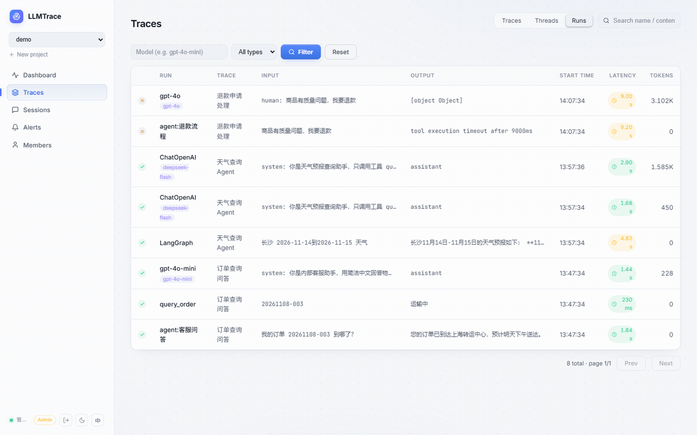
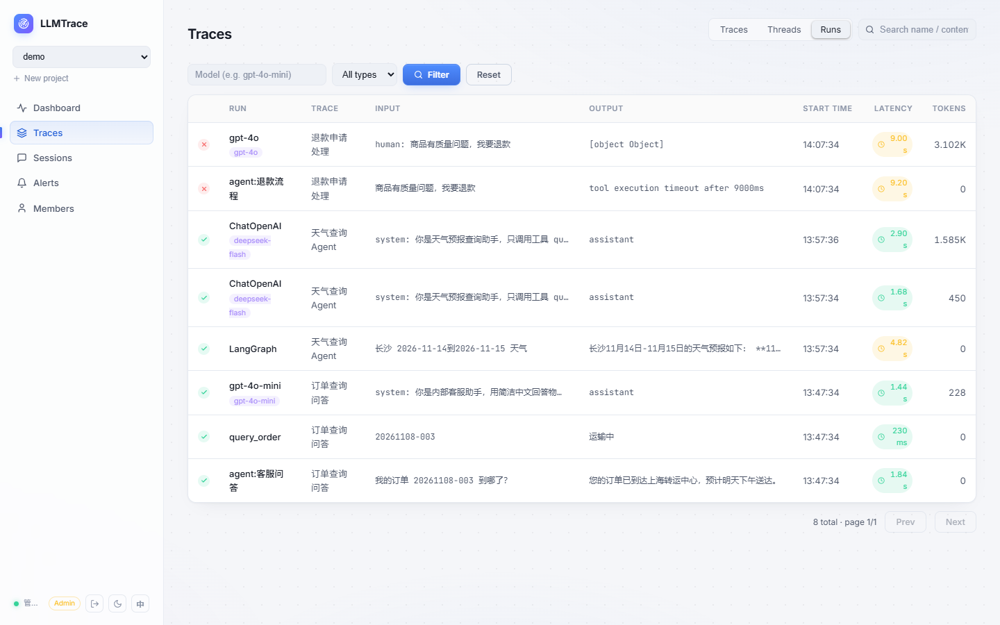
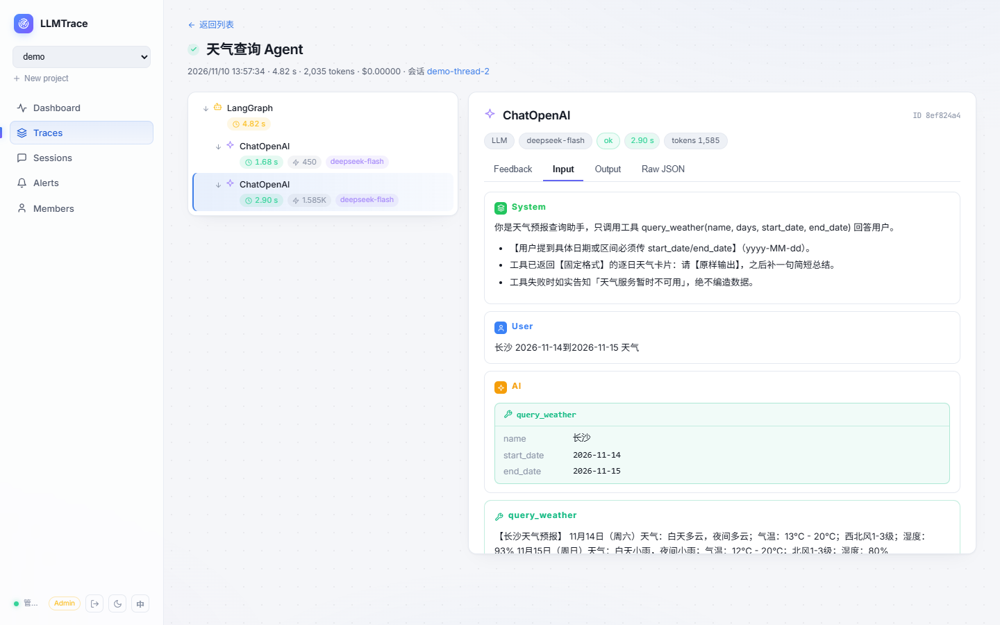
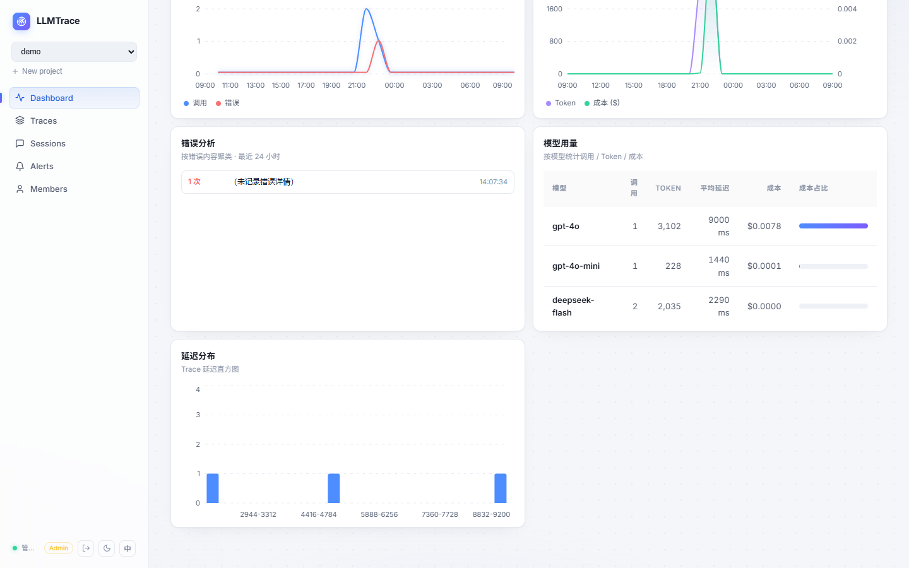
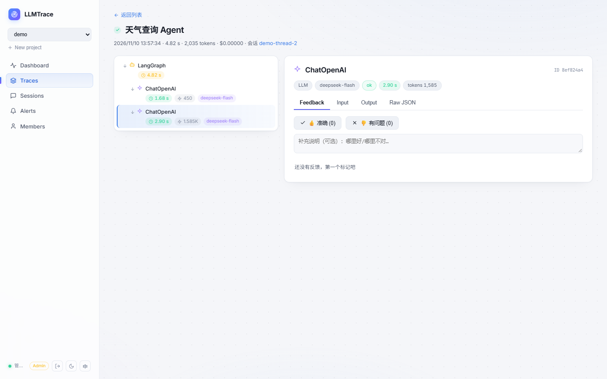

<div align="center">

# LLMTrace

Self-hosted tracing and monitoring for LLM applications.

[](../../actions)
[](LICENSE)
[](https://www.python.org)

[English](README.md) | [中文文档](README.zh-CN.md)

</div>

---

LLMTrace is a self-hosted observability platform for LLM applications: trace-level
monitoring with full input/output visibility, cost & latency metrics, sessions,
alerting, SSO, RBAC — in a single container.

<p align="center">
  
</p>

```text
Python SDK ──async ingest──▶ FastAPI ──▶ PostgreSQL / SQLite
                                │
                     React dashboard ◀── aggregated queries
              (runs table · span tree · message bubbles · charts)
```

## Why LLMTrace

- Full prompts, completions and tool calls, rendered as chat bubbles instead
  of raw JSON dumps
- Single container. SQLite for trials, PostgreSQL for production
- Traces / Threads / Runs views, span tree, latency and token badges,
  feedback (up/down)
- Self-hosted: prompts never leave your network
- Feishu SSO login, Feishu / DingTalk / WeCom webhook alerts
- One-line SDK: `llmtrace.wrap_openai(client)`

## Features

| Area | Highlights |
|------|------------|
| Tracing | Trace/span tree (llm / tool / retrieval / agent / chain), full I/O, tokens, cost, errors |
| Runs & Sessions | Flat runs list, session aggregation, full-text search over inputs/outputs/errors |
| Dashboard | Calls, error rate, avg/P95 latency, token & cost charts, model stats, error clustering |
| Alerting | Threshold rules (error rate / latency), webhook (JSON / Feishu / DingTalk / WeCom + HMAC), cooldown |
| Auth | Password login, email verification-code login; admin/member/viewer RBAC |
| Teams | Multi-tenant teams: create a team and get API keys for your own apps, or join one with an invite code; projects and data are isolated per team |
| SDK | `wrap_openai` / `wrap_anthropic` (streaming), `@trace`/`@span` decorators, batch + disk buffer, PII masking |
| LangSmith-compatible | LangChain's built-in tracer works against LLMTrace via `LANGSMITH_*` env vars, no code changes |
| OpenTelemetry | OTLP/HTTP(JSON) ingestion (`/api/v1/otel/v1/traces`) — GenAI & OpenInference conventions mapped automatically |
| Ops | Alembic migrations, data retention per project, CSV/JSON export, audit logs, demo seeding |

## Screenshots

| Runs view | Trace detail (messages & tool calls) |
|---|---|
|  |  |

| Dashboard | Feedback |
|---|---|
|  |  |

## Quick start

```bash
git clone https://github.com/zfan980816/llmtrace && cd llmtrace
cp .env.example .env          # set JWT_SECRET; SEED_DEMO=true injects demo data
docker compose up -d --build
```

Open http://localhost:8000 — log in with **admin / admin123** (change it immediately).

First start runs Alembic migrations automatically and (optionally) seeds a demo
project with three representative traces, so the UI is alive out of the box.

### Trace your first call

```bash
pip install llmtrace-observability
```

Don't have an app to instrument yet? Send a sample trace and see the UI working:

```bash
llmtrace demo --url http://localhost:8000 --key <project-api-key>
```

Then instrument real calls with one line:

```python
from openai import OpenAI
from llmtrace import wrap_openai

client = wrap_openai(OpenAI())      # every call is now traced

resp = client.chat.completions.create(
    model="gpt-4o-mini",
    messages=[{"role": "user", "content": "Hello, LLMTrace!"}],
)
```

Already shipping traces via OpenTelemetry? Point your OTLP exporter at
`POST {base}/api/v1/otel/v1/traces` with your `X-API-Key` — GenAI and
OpenInference span attributes are mapped automatically.

Plain functions work too:

```python
from llmtrace import trace, span, record_llm_call

@trace(name="rag-chat", session_id="user-1")
def answer(question: str):
    with span("retrieve", span_type="retrieval", input={"q": question}):
        docs = search(question)

    record_llm_call(model="gpt-4o-mini", input=messages, output=answer_text,
                    prompt_tokens=p, completion_tokens=c)
    return answer_text
```

## Zero-code LangChain tracing (LangSmith-compatible)

Any LangChain / LangGraph app can switch from LangSmith to LLMTrace **without
touching a single line of code** — LangChain's built-in tracer posts runs to
LLMTrace natively (JSON batch and multipart endpoints are both implemented):

```bash
# .env — switch between LangSmith and LLMTrace by editing these four lines
LANGSMITH_TRACING=true
LANGSMITH_ENDPOINT=http://localhost:8000     # ← your LLMTrace host
LANGSMITH_API_KEY=<LLMTrace project API key>
LANGSMITH_PROJECT=<project name>
```

That's it. Every chain / agent / tool / retriever / LLM call shows up as a
trace tree with full inputs, outputs, tokens, latency and errors — including
streaming, parallel graph branches and LangGraph checkpoints. To switch back
to LangSmith, just point `LANGSMITH_ENDPOINT` at `api.smith.langchain.com`.

## Development

```bash
# backend
cd backend && pip install -r requirements.txt
alembic upgrade head
uvicorn app.main:app --reload --port 8000

# frontend (hot reload)
cd frontend && npm install && npm run dev
```

Tests: `python smoke_test.py && python auth_test.py && ...` (see `backend/*_test.py`).

## Environment variables

See [.env.example](.env.example) — database URL, JWT secret, SSO providers
(Feishu / OIDC / GitHub), seed switch.

## License

[Apache-2.0](LICENSE)
