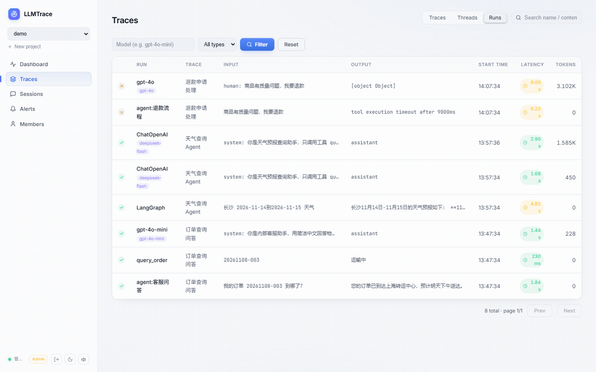
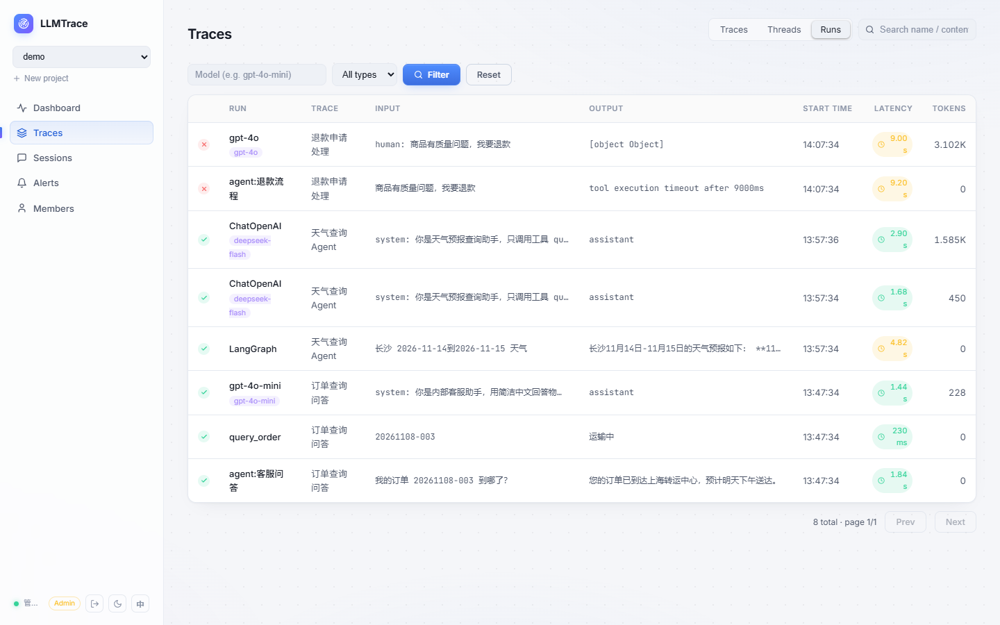
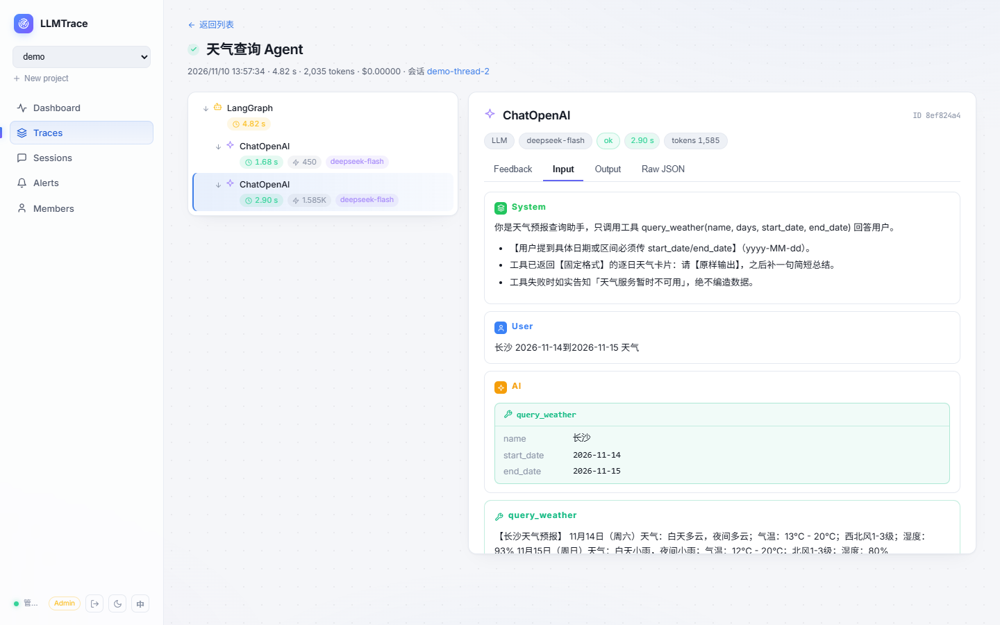

# LLMTrace

一个类 LangSmith 的 **LLM 监控平台 MVP**：链路追踪 + 指标仪表盘。

```
Python SDK ──异步上报──▶ FastAPI ──▶ PostgreSQL
                             │
                  React 仪表盘 ◀── 聚合查询
              (监控卡片 + 图表 + 链路瀑布图)
```

## 功能

- **链路追踪**：每次请求一条 Trace，内部步骤为 Span（llm / tool / retrieval / agent / chain），
  记录输入输出、模型、token 用量、延迟、成本、错误
- **指标仪表盘**：总调用数、错误率、平均/P95 延迟、Token 消耗、成本趋势（近 24h 图表）
- **告警**：规则化阈值告警（错误率 / 平均延迟 / P95 延迟），后台每 60s 自动检测，支持 Webhook 通知（通用 JSON / 飞书 / 钉钉格式），带冷却去重，也可在前端手动触发
- **会话视图**：按 session_id 自动聚合多轮调用，会话列表 + 会话内全部链路
- **SDK 自动埋点**：`wrap_openai` / `wrap_anthropic` 一行代码接入 OpenAI / Anthropic 客户端（含流式）；装饰器同时支持同步与异步函数
- **多项目**：前端项目切换器 + 独立 API Key，数据按项目隔离
- **登录方式**：账号密码（JWT）、邮箱验证码登录（新邮箱自动注册，默认可查看监控）；管理员 / 成员 / 只读三级角色
- **团队多租户**：登录后可创建自己的团队（生成项目 API Key 接入自己的应用），或凭邀请码加入他人团队；项目与数据按团队隔离
- **敏感信息脱敏**：手机号 / 邮箱 / 身份证号，SDK 端与服务端双重支持（项目级开关）
- **数据保留策略**：项目级保留天数，后台每小时自动清理过期链路
- **生产部署**：多阶段 Dockerfile + docker-compose 一键部署，前端静态托管于后端（单端口）
- **SDK 批量上报 + 落盘缓冲**：攒批发送，失败写本地磁盘，恢复后自动重传
- **时间范围选择**：仪表盘 1h / 6h / 24h / 7d / 30d 自由切换
- **企业微信告警 + HMAC 签名**：webhook 可带密钥防伪造（X-LLMTrace-Signature）
- **数据导出**：Trace 列表一键导出 CSV / JSON
- **审计日志**：用户 / 项目 / 规则的关键操作全记录，仅管理员可查
- **成本估算**：内置常见模型单价表（`backend/app/services/cost.py`），按 token 自动折算
- **Web 控制台**：Trace 列表（状态筛选）、详情页瀑布图、Span 输入/输出展开

## 界面预览

<p align="center">
  
</p>

| Runs 视图 | Trace 详情（消息与工具调用） |
|---|---|
|  |  |

## 快速开始

### 方式一：Docker 一键部署（推荐）

```bash
git clone https://github.com/zfan980816/llmtrace.git && cd llmtrace
cp .env.example .env        # 按需修改 JWT_SECRET（SEED_DEMO=true 可注入示例数据）
docker compose up -d --build
```

打开 http://localhost:8000 ，默认管理员 **admin / admin123**，首次登录会强制设置新密码。

- 首次启动自动执行数据库迁移（`alembic upgrade head`）
- `SEED_DEMO=true`（默认）时自动注入 demo 项目与三条示例 trace，开箱即可体验完整界面
- 生产环境务必修改 JWT_SECRET，并可将 `SEED_DEMO=false`

### 接入应用

```bash
pip install llmtrace-observability
```

还没有要接入的应用？先发一条测试 trace 看看 UI：

```bash
llmtrace demo --url http://localhost:8000 --key <项目 API Key>
```

### 方式二：本地开发

```bash
# 1. 数据库（或直接用 SQLite：DATABASE_URL=sqlite:///./llmtrace.db）
docker compose up -d db

# 2. 后端
cd backend
pip install -r requirements.txt
alembic upgrade head        # 建表/升级结构
uvicorn app.main:app --reload --port 8000

# 3. 前端
cd frontend

### 方式二：本地开发

```bash
# 1. 数据库
docker compose up -d db

# 2. 后端（自动建表 + 种子管理员）
cd backend
pip install -r requirements.txt
uvicorn app.main:app --reload --port 8000

# 3. 前端
cd frontend
npm install
npm run dev
```

打开 http://localhost:5173 并登录。API 文档：http://localhost:8000/docs

### 环境变量

| 变量 | 说明 |
|------|------|
| DATABASE_URL | 数据库连接串 |
| JWT_SECRET | JWT 签名密钥（生产必改，>=32 字符） |
| STATIC_DIR | 前端静态目录（Docker 镜像内已默认） |

### 用 SDK 上报

```python
# SDK 端脱敏（可选，发送前在本进程内完成）
configure(..., masking=True)  # 或 ["phone", "email"]
```

```python
import time
from llmtrace import configure, trace, span, record_llm_call

# 在前端控制台或 GET /api/v1/projects 拿到 api_key 和 id
configure(api_url="http://localhost:8000", api_key="<APIKey>", project_id="<项目ID>")

@trace(name="rag-chat", session_id="user-123")
def answer(question):
    with span("retrieve", input={"question": question}):
        docs = ["..."]  # 你的检索逻辑

    start = time.time()
    # ... 调用你的 LLM ...
    time.sleep(0.2)
    record_llm_call(
        model="gpt-4o-mini",
        input=[{"role": "user", "content": question}],
        output={"role": "assistant", "content": "答案..."},
        prompt_tokens=120, completion_tokens=80,
        latency_ms=int((time.time() - start) * 1000),
    )
    return "答案..."

answer("hello")
```

刷新前端即可看到链路与指标。

## 飞书 SSO 登录

1. 在[飞书开放平台](https://open.feishu.cn)创建企业自建应用，开通「获取用户基本信息」权限。
2. 在应用的安全设置中添加重定向 URL：`http://<你的后端地址>/api/auth/feishu/callback`。
3. 后端启动前设置环境变量：

```bash
FEISHU_APP_ID=cli_xxx           # 应用 App ID
FEISHU_APP_SECRET=xxx           # 应用 App Secret
# 可选：
FEISHU_REDIRECT_URI=            # 留空按请求自动推导
FEISHU_DEFAULT_ROLE=member      # 飞书新用户默认角色 admin|member|viewer
```

- 未配置时登录页自动隐藏飞书按钮。
- 首次登录按 `feishu_open_id` 匹配已有账号，无匹配则自动建号（用户名取飞书邮箱，缺省 `feishu_<id>`）。
- 登录成功签发本平台 JWT 并重定向回前端，角色/权限与密码登录一致。

## API 一览

| 方法 | 路径 | 说明 |
|------|------|------|
| POST | `/api/v1/projects` | 创建项目（返回 api_key） |
| GET  | `/api/v1/projects` | 项目列表 |
| POST | `/api/v1/traces/ingest` | 上报 trace（Header: `X-API-Key`） |
| GET  | `/api/v1/traces` | Trace 列表（`?status=&limit=`） |
| GET  | `/api/v1/traces/{id}` | Trace 详情（含 spans） |
| GET  | `/api/v1/metrics/overview` | 汇总指标（`?hours=24`） |
| GET  | `/api/v1/metrics/timeseries` | 按小时时序指标 |
| POST | `/api/v1/alerts/rules` | 创建告警规则（Header: `X-API-Key`） |
| GET  | `/api/v1/alerts/rules` | 规则列表 |
| PATCH | `/api/v1/alerts/rules/{id}` | 更新规则（启停/阈值） |
| DELETE | `/api/v1/alerts/rules/{id}` | 删除规则 |
| GET  | `/api/v1/alerts/events` | 告警事件列表 |
| POST | `/api/v1/alerts/evaluate` | 立即执行一轮检测 |
| GET  | `/api/v1/sessions` | 会话列表（按 session 聚合） |
| GET  | `/api/v1/sessions/{session_id}` | 会话内全部 trace |

## 目录结构

```
backend/   FastAPI 后端（接口、数据模型、指标聚合、告警引擎与成本估算）
sdk/       Python SDK（llmtrace 包）
frontend/  React + Vite 控制台
docker-compose.yml
```

## Roadmap（后续）

- 大规模存储：ClickHouse / TimescaleDB（当前 Postgres 单机可支撑百万级 Span，量大时再迁移）
- 用户账号与团队权限体系（当前为多项目 + API Key 模式）
- SDK：LangChain / LlamaIndex 官方集成
- 前端：Trace 对比视图、下载导出